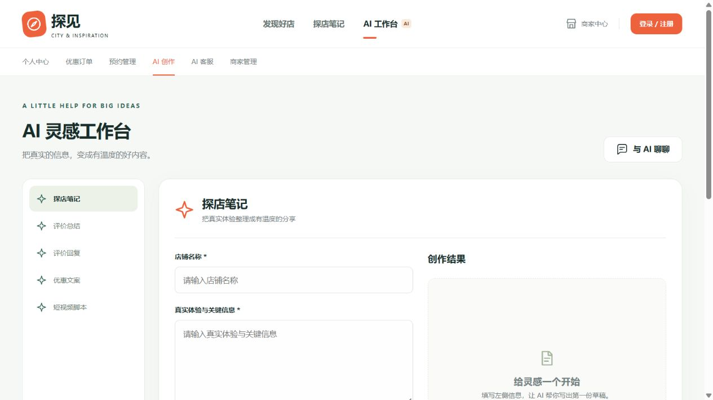
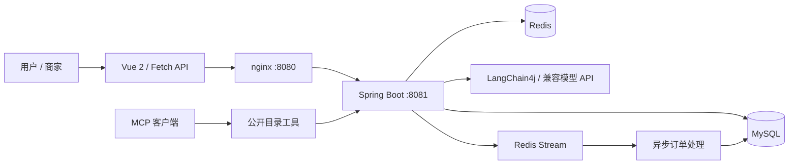

<div align="center">

# 探见 · AI 本地生活与智能经营平台

**hmdp-Java · 店铺发现、内容互动、到店预约与 AI 创作**

将用户的城市生活体验，与商家的内容创作、优惠和预约处理连接起来。


[](https://github.com/lipenglai0720/hmdp-Java/actions/workflows/test.yml)

[快速开始](#快速开始) · [架构设计](docs/architecture.md) · [部署指南](docs/deployment.md) · [功能对照](AI-dianping-frontend/FEATURE-COVERAGE.md) · [压测指南](performance/jmeter/README.md)

</div>


## 项目介绍

探见基于 Spring Boot 3、MySQL、Redis 与 Vue 2，实现店铺发现、探店笔记、用户互动、优惠券订单、到店预约和商家管理，并集成 LangChain4j AI 对话、场景化内容 Skills 与 MCP 公开目录工具。

前端采用无需构建的 Vue 页面与 nginx 反向代理，后端负责账号会话、业务权限、缓存与异步订单处理。仓库保留可复现的单元测试、前端模板验证和 JMeter 计划。

## 核心功能

| 模块 | 能力 |
| --- | --- |
| 店铺发现 | 分类、名称搜索、附近店铺、详情与优惠展示 |
| 内容与互动 | 探店笔记、图片上传、点赞、一级评论与关注 |
| 用户中心 | 手机验证码登录、个人资料、签到与订单查询 |
| 到店预约 | 用户提交 / 取消，已授权商家确认 / 拒绝 |
| 商家管理 | 绑定店铺的信息维护、普通优惠与限时优惠发布 |
| 优惠券订单 | Lua 原子校验与预扣库存，Redis Stream 消费，幂等落库与结果查询 |
| AI 工作台 | 探店笔记、评价总结、评价回复、优惠文案与短视频脚本；生成记录可查询 |
| AI 对话与 MCP | 按用户隔离对话会话，通过 MCP 暴露公开店铺目录查询 |

<details>
<summary>查看 AI 工作台预览</summary>

### AI 创作工作台



</details>

截图由当前仓库的前端页面配合独立 Mock 数据渲染，不包含真实用户数据，也未调用模型。正常运行时优先展示商户原始图片，缺图时的配图会标注用途。

## 架构概览



订单处理通过 Redis 原子校验、消费组恢复、Redisson 锁和数据库事务完成；具体实现与源码入口见 [架构设计](docs/architecture.md)。

## 技术栈

| 层次 | 技术 |
| --- | --- |
| 后端 | Java 17、Spring Boot 3.5.6、MyBatis-Plus |
| 数据与缓存 | MySQL 8、Redis、Redisson、Lua、Stream、GEO |
| AI | LangChain4j、OpenAI-compatible API、MCP SDK |
| 前端 | Vue 2、Fetch API、原生 HTML / CSS |
| 验证 | JUnit 5、Mockito、Node.js 模板检查、Apache JMeter |

## 快速开始

需要 JDK 17、Maven、MySQL 8 与 Redis。Windows 可直接使用仓库内的 nginx 程序；其他系统可使用自行安装的 nginx 并调整静态资源目录。

```bash
git clone https://github.com/lipenglai0720/hmdp-Java.git
cd hmdp-Java
```

**1. 创建本地配置**

```powershell
Copy-Item AI-dianping-backend/src/main/resources/application.example.yml AI-dianping-backend/src/main/resources/application.yml
```

配置数据库、Redis、模型地址与上传目录。密码和模型密钥可通过 `DB_PASSWORD`、`REDIS_PASSWORD`、`DEEPSEEK_API_KEY` 环境变量提供；`application.yml` 已被 Git 忽略。Linux / macOS 可用 `cp` 复制配置。

**2. 初始化数据库**

在新建的空 `hmdp` 数据库中导入 `db.sql`，再按部署指南执行 AI、预约和索引的增量脚本。`db.sql` 包含删表语句，只用于空库初始化。

```sql
CREATE DATABASE hmdp CHARACTER SET utf8mb4 COLLATE utf8mb4_unicode_ci;
```

导入顺序、已有数据库升级与商家绑定方法见 [部署指南](docs/deployment.md)。

**3. 启动后端**

```bash
mvn -f AI-dianping-backend/pom.xml spring-boot:run
```

也可在 IDEA 中运行 `HmDianPingApplication`。后端默认监听 8081。

**4. 启动前端**

在 Windows PowerShell 中执行：

```powershell
cd AI-dianping-frontend
New-Item -ItemType Directory -Path logs,temp -Force | Out-Null
.\nginx.exe -t
Start-Process -FilePath ".\nginx.exe" -WorkingDirectory (Get-Location).Path -WindowStyle Hidden
```

访问 <http://localhost:8080/>。修改 nginx 配置后执行 `.\nginx.exe -s reload`。上传目录应与 `conf/nginx.conf` 中 `/imgs/` 的 `alias` 保持一致。

## 测试与性能验证

```bash
mvn -f AI-dianping-backend/pom.xml test
node scripts/verify_frontend.cjs
```

后端单元测试与前端模板检查已接入 GitHub Actions。需要真实数据库、Redis 或批量写入的手工测试默认不执行，只有显式设置 `HMDP_RUN_MANUAL_TESTS=true` 才会开启。

JMeter 提供登录、混合读取、秒杀、重复领取、普通券领取和预约六套计划，使用独立测试环境。运行方式见 [压测指南](performance/jmeter/README.md)，已有小规模验证见 [冒烟记录](performance/jmeter/SMOKE-RESULTS.md)。该记录用于验证流程，不代表系统最大吞吐量。

## 项目结构

```text
AI-dianping-backend/
├── db/                  # 业务初始化与增量升级 SQL
├── src/main/java/       # Controller、Service、缓存、订单与 MCP
├── src/main/resources/  # 配置模板、Mapper、Lua 与模型系统提示
└── src/test/            # 后端自动化测试
AI-dianping-frontend/
├── conf/                # nginx 与 MIME 配置
├── html/hmdp/           # Vue 入口、视图、脚本与样式
├── docs/                # 随 nginx 保留的第三方许可证
└── nginx.exe            # Windows 本地运行程序
docs/                    # 架构、部署与界面预览
performance/jmeter/      # 压测计划、隔离环境管理与结果分析
scripts/                 # 前端模板与资源校验
```

## 功能边界

验证码当前写入本地开发日志，尚未接入短信；普通优惠只展示信息，系统未集成真实支付、核销或退款。预约尚不包含时段容量控制与商家通知。AI 内容是待人工确认的草稿，个人订单、预约和 AI 调用不会作为匿名 MCP 工具暴露。

演示数据中的“演示”店铺、用户、优惠和预约为虚构内容。应用对外使用前，需要补齐短信、账号管理、业务通知和实际部署验证。第三方库与 nginx 的许可证按原文件保留。
