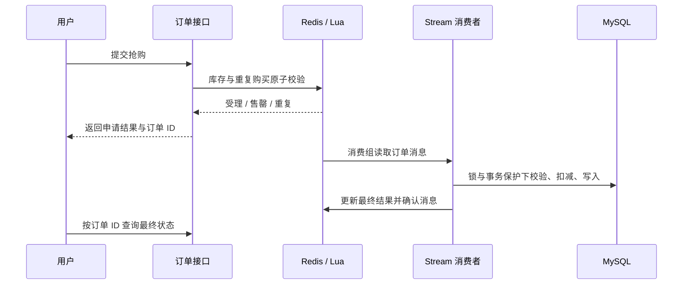

# 架构设计

[返回项目首页](../README.md)

## 请求与身份

Vue 页面通过 `/api` 访问 nginx，nginx 去掉该前缀后将请求转发到 Spring Boot 8081。登录会话保存在 Redis，拦截器加载当前用户，业务服务进一步校验订单、预约和商家店铺的归属。

## 店铺与缓存

店铺服务结合 Redis 缓存、空值缓存、逻辑过期与互斥重建处理热点读取；GEO 索引用于附近店铺查询。缓存失效和数据库索引属于工程实现，不代表已经获得某个固定吞吐量。

## 异步优惠券订单

受理结果和最终落库结果分开。消费端恢复 pending 消息，并在事务中检查历史订单与剩余库存；数据库唯一约束为重复消费提供额外保护。已有数据库升级时应执行 `performance_upgrade.sql`。

## 预约与商家权限

预约由用户创建和取消，商家只能处理已绑定店铺的预约。店铺绑定通过管理员执行 SQL 完成，前端隐藏入口不能替代服务端权限校验。

## AI 与 MCP

AI Skills 读取技能定义、校验表单、渲染提示模板、调用模型并保存运行记录。对话会话按当前用户隔离。MCP 通过 `/mcp` 以 HTTP 传输提供公开目录查询，个人预约、订单和生成操作由业务接口的身份与权限体系处理。

## 源码导航

| 入口 | 职责 |
| --- | --- |
| [VoucherOrderServiceImpl](../AI-dianping-backend/src/main/java/com/hmdp/service/impl/VoucherOrderServiceImpl.java) | Lua、Stream 消费、恢复与结果查询 |
| [VoucherOrderProcessor](../AI-dianping-backend/src/main/java/com/hmdp/service/VoucherOrderProcessor.java) | 锁、事务、库存与幂等订单落库 |
| [ReservationServiceImpl](../AI-dianping-backend/src/main/java/com/hmdp/service/impl/ReservationServiceImpl.java) | 预约状态与归属校验 |
| [AiSkillServiceImpl](../AI-dianping-backend/src/main/java/com/hmdp/service/impl/AiSkillServiceImpl.java) | 场景技能与生成记录 |
| [McpServerConfig](../AI-dianping-backend/src/main/java/com/hmdp/mcp/config/McpServerConfig.java) | MCP HTTP 服务与身份上下文 |
| [前端功能对照](../AI-dianping-frontend/FEATURE-COVERAGE.md) | 页面入口与后端能力 |
